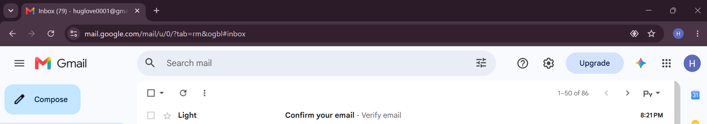
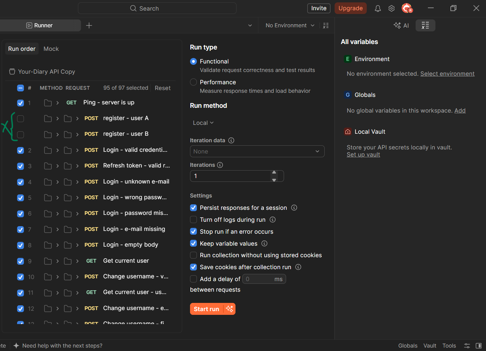

## API Documentation

- API Documentation: [Swagger UI](https://ilkarion.github.io/APITesting_Your_diary/)
- Postman Collection: [Postman](https://github.com/Ilkarion/APITesting_Your_diary/blob/main/Your-Diary%20API.postman_collection.json)
- Test Plan: [Plan](https://github.com/Ilkarion/APITesting_Your_diary/blob/main/Test_Plan.md)

# API Testing — Your Diary

  
  

  
  

## Project Overview

This project demonstrates manual API testing with Postman test scripts (JavaScript) API testing of a diary application using Postman.

The goal was to verify API functionality, validate responses, test authentication, and identify potential issues in backend validation.

## Tools & Technologies

- **Postman** — API requests, test scripts, and assertions
- **JavaScript** — automated checks within Postman
- **OpenAPI / Swagger UI** — API documentation
- **GitHub** — version control and project documentation

## Testing Scope

- User registration and login
- Authentication and session cookies
- User profile endpoints
- Diary entry operations
- Positive and negative scenarios
- Response status, body, and schema validation
- Backend input validation
