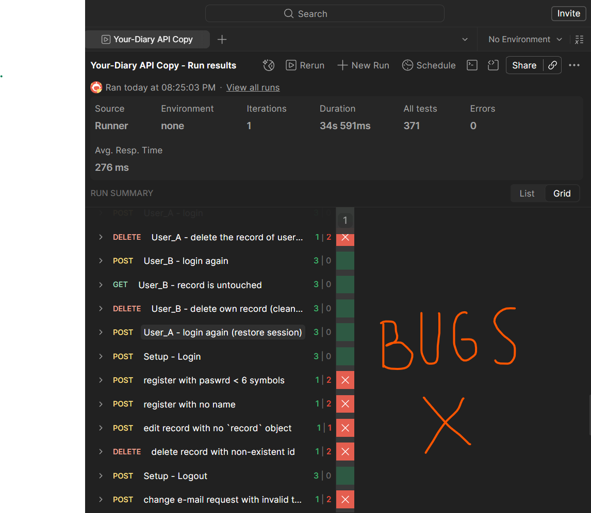

## Issues found during API testing. Status: Open.



> All bugs and their documentation can also be found in my [Postman Collection](https://github.com/Ilkarion/APITesting_Your_diary/blob/main/Your-Diary%20API.postman_collection.json).

---

## Bugs Description:

---

### 1) User_A - delete the record of user_B.
> Status: Open

`{{base}}/api/diary-delete/{{rt_record_id_b}}`

**Summary:** deletion attempt returns 200 OK instead of 404 Not Found.

**Steps to Reproduce:**

1. Authenticate as User A.
2. Send a DELETE request to `/api/diary-delete/{{rt_record_id_b}}` targeting a record owned by User B.

**Actual Behavior:**
The API responds with 200 OK and indicates the record was deleted, even though no deletion occurred.

**Expected Behavior:**
The API should respond with 404 Not Found and the following body:

```json
{ "message": "Record not found" }
```

**Acceptance Criteria:**

- User A cannot delete records belonging to User B.
- The record of User B remains intact after the request.
- The response status is 404 with the message above.

---

### 2) register with paswrd < 6 symbols.
> Status: Open

> The API documentation does not require this; the rule exists only in the frontend. Validation mismatch between frontend and backend.

`{{base}}/api/register`

**Bug:** Server Does Not Validate Password Length During Registration

The frontend prevents the user from submitting a password shorter than 6 characters. However, when the same request is sent directly to the server via Postman, the server does not validate the password length and may return a success status.

**Requirement:** The password must be at least 6 characters long.

**Steps to Fix the Bug**

1. Open the server-side code.
2. Locate the registration endpoint.
3. Add server-side validation to ensure the password contains at least 6 characters.
4. `{ "message": "Password must be at least 6 characters long."}`

**Steps to Reproduce the Bug**

1. Open the registration page.
2. Try to register with a password containing 1–5 characters.
3. Observe that the frontend displays a validation error.
4. Open Postman and send the same registration request directly to the server, using a password containing 1–5 characters.
5. Observe that the server returns a success status instead of rejecting the invalid request.

**Expected Result**
The server should reject registration requests containing passwords shorter than 6 characters and return an appropriate error response.

**Actual Result**
The server accepts the request and returns a success status despite the password violating the requirement.

---

### 3) register with no name
> Status: Open

> The API documentation does not require this; the rule exists only in the frontend. Validation mismatch between frontend and backend.

`{{base}}/api/register`

**Bug:** Server Does Not Validate Username During Registration

The frontend prevents users from submitting the registration form without a username. However, when the same request is sent directly to the server via Postman, the server does not validate the username field and may return a success status.

**Requirement:** A username must be provided during registration.

**Steps to Fix the Bug**

1. Open the server-side code.
2. Locate the registration endpoint.
3. Add server-side validation to ensure that the username is provided.
4. `{ "message": "Username is required."}`

**Steps to Reproduce the Bug**

1. Open the registration page.
2. Try to register without entering a username.
3. Observe that the frontend displays a validation error.
4. Open Postman and send the registration request directly to the server without a username.
5. Observe that the server returns a success status instead of rejecting the invalid request.

**Expected Result**
The server should reject registration requests with a missing or empty username and return an appropriate error response.

**Actual Result**
The server accepts the request and returns a success status even though the required username is missing.

---

### 4) edit record with no `record` object
> Status: Open

`{{base}}/api/diary-edit`

When a request is sent to `/api/diary-edit` without wrapping the payload inside a record object, the API returns an incorrect error message.

**Steps to Reproduce**

1. Send a POST request to `{{base}}/api/diary-edit`.
2. Include a valid-looking JSON body but without the required record wrapper object.
3. Observe the response.

**Actual Result**

```json
{ "message": "Invalid token" }
```

**Expected Result**

```json
{ "message": "Invalid json object" }
```

**Impact**
The misleading error message ("Invalid token") suggests an authentication problem rather than a malformed request body. This makes debugging harder for API consumers, as they may incorrectly investigate their auth token instead of their request payload structure.

**Severity**
Medium — Incorrect error messaging; does not expose sensitive data but causes confusion.

---

### 5) delete record with non-existent id
> Status: Open

`{{base}}/api/diary-delete/00000000-0000-0000-0000-000000000000`

**Bug (to verify):** Deleting a record that does not exist reports success

**Status:** Unconfirmed. Derived from the API specification (the handler answers 200 whenever the database reports no error). Run this request to confirm. If both tests pass, move it to the regression tests.

**Requirement:** The API must tell the client when nothing was deleted.

**Steps to Reproduce the Bug**

1. Log in.
2. Send a DELETE request to `{{base}}/api/diary-delete/00000000-0000-0000-0000-000000000000`.
3. Observe the response.

**Expected Result**

```
HTTP 404
{ "message": "Record not found" }
```

**Actual Result**

```
HTTP 200
{ "message": "Record deleted" }
```

**Impact**
The client cannot tell a real deletion from a deletion of a wrong id, so errors in the client code stay hidden.

**Severity**
Low

---

### 6) change e-mail request with invalid token
> Status: Open

`{{base}}/api/change-email-request`

**Bug (to verify):** Invalid access token on `/api/change-email-request` returns 500 instead of 401

**Status:** Unconfirmed. Derived from the API specification (every error inside the handler, including a bad token, is answered with 500). Run this request to confirm.

**Requirement:** All protected endpoints answer an invalid or expired token with 401 `{ "message": "Invalid token" }`.

**Steps to Reproduce the Bug**

1. Make sure no session cookies are stored (run Setup - Logout first).
2. Send a POST request to `{{base}}/api/change-email-request` with the header `Cookie: access_token=invalid.token.value`.
3. Observe the response.

**Expected Result**

```
HTTP 401
{ "message": "Invalid token" }
```

**Actual Result**

```
HTTP 500
{ "message": "Server error" }
```

**Impact**
A client cannot tell an expired session (should log in again) from a real server failure. Server errors are also counted as incidents in monitoring.

**Severity**
Medium
